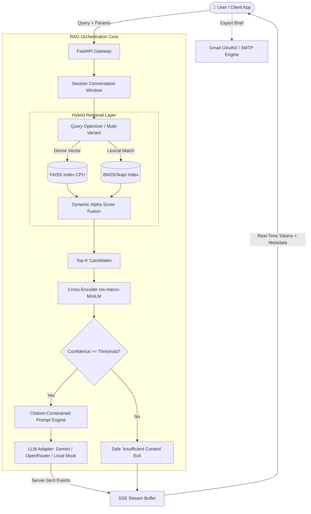

# ⚖️ AdhikarAI (अधिकार AI)

> **Enterprise-Grade, Hallucination-Guarded Legal Intelligence Engine for Indian Labour Law**

[](LICENSE)
[](https://www.python.org/)
[](https://fastapi.tiangolo.com/)
[](https://react.dev/)
[](https://vitejs.dev/)
[](https://tailwindcss.com/)
[](https://github.com/facebookresearch/faiss)
[](https://github.com/yashcsv/AdhikarAI/pulls)

---

## 📌 Table of Contents

- [Overview](#-overview)
- [Key Features](#-key-features)
- [Architecture & Data Pipeline](#-architecture--data-pipeline)
- [Supported Statutory Corpus](#-supported-statutory-corpus)
- [Tech Stack](#-tech-stack)
- [Repository Structure](#-repository-structure)
- [Quick Start Guide](#-quick-start-guide)
  - [Prerequisites](#prerequisites)
  - [1. Backend Setup](#1-backend-setup)
  - [2. Frontend Setup](#2-frontend-setup)
- [Pipeline Operations](#-pipeline-operations)
  - [Document Ingestion](#document-ingestion)
  - [FAISS Vector Indexing](#faiss-vector-indexing)
- [API Specification](#-api-specification)
- [Architectural Decision Records (ADRs)](#-architectural-decision-records-adrs)
- [Reliability & Failure Engineering](#-reliability--failure-engineering)
- [Legal Disclaimer](#-legal-disclaimer)
- [License](#-license)

---

## 💡 Overview

Indian Labour Law encompasses hundreds of fragmented statutory provisions, historical enactments dating back to 1923, and the newly consolidated **4 Labour Codes (2019–2020)**. When HR managers, MSME owners, workers, or junior advocates query generic commercial LLMs (e.g. ChatGPT, Claude), these models routinely hallucinate section numbers, conflate repealed acts with new codes, or output confident but legally catastrophic advice.

**AdhikarAI** is engineered from the ground up as a **zero-hallucination, citation-grounded Legal RAG (Retrieval-Augmented Generation) system**. It combines:
1. **Sub-second Hybrid Retrieval (BM25 Sparse + FAISS Dense)** tailored for exact statutory nomenclature and semantic queries.
2. **Cross-Encoder Reranking** running efficiently on CPU infrastructure.
3. **Strict Evidence Gating** that aborts generation with an explicit "Insufficient Context" safeguard rather than fabricating legal answers.
4. **Interactive SSE Streaming with Full Stream Control** (Pause, Resume, Stop) and multi-channel delivery (Web UI & automated HTML Legal Brief email dispatch).

---

## ✨ Key Features

- **🎯 Localized Hybrid Search Pipeline**
  - **Dense Semantic Retrieval:** `sentence-transformers/all-MiniLM-L6-v2` vectorized over FAISS.
  - **Sparse Lexical Retrieval:** `BM25Okapi` keyword index capturing exact section numbers (e.g., *"Section 43B"*, *"Form XI-A"*).
  - **Dynamic Alpha Fusion:** Tunable balance (`alpha ∈ [0.0, 1.0]`) to bias towards statutory precision or semantic intent.

- **🛡️ Evidence-Gated Anti-Hallucination Guardrails**
  - Responses are strictly bound to retrieved Act/Section context.
  - Hard confidence abort: If the reranked evidence score falls below statutory thresholds, generation cleanly halts with an honest, actionable fallback.
  - Every assertion links to source metadata: **Act Name**, **Section Number**, and **Verbatim Statutory Excerpts**.

- **⚡ Real-Time SSE Token Streaming & Stream Control**
  - Instant Time-to-First-Token (TTFT) via Server-Sent Events (`/api/chat/stream`).
  - Active stream lifecycle management: pause buffered output, resume stream on demand, or abort in flight.

- **🎭 Multi-Persona & Depth Modulation**
  - **Lawyer Mode:** Formal statutory reasoning, strict legal bases, and compliance checklists.
  - **Layman / Worker Mode (ELI5):** Plain-language breakdowns of worker rights and wage entitlements.
  - **Thinking Mode:** Deep step-by-step legal decomposition before synthesizing final guidance.

- **🔑 Privacy-First Client-Side Key Management**
  - API keys (Google Gemini, OpenRouter) can be passed directly from client local storage via request headers (`X-Gemini-API-Key`).
  - Keys are never persisted in backend databases or server logs.
  - Model caching is isolated per key hash `(model_name, api_key_hash)` to prevent multi-tenant contamination.

- **📧 Automated Legal Brief Delivery**
  - Convert any chat consultation into a structured HTML legal memo sent directly to the client's inbox.
  - Dual provider support: **Gmail OAuth2** or standard **SMTP** with strict CR/LF sanitization against header injection.

- **📊 Comprehensive Observability**
  - Response payloads include granular latency breakdowns (`retrieval_time_ms`, `rerank_time_ms`, `generation_time_ms`).
  - Optional zero-code **LangSmith** telemetry integration.

---

## 🏛 Architecture & Data Pipeline



---

## 📚 Supported Statutory Corpus

AdhikarAI ships with pre-ingested, chunked, and indexed corpora spanning the full breadth of India's labour jurisprudence:

| Category | Acts & Statutory Codes Included |
| :--- | :--- |
| **New 4 Labour Codes** | • **Code on Wages, 2019**<br>• **Industrial Relations Code, 2020**<br>• **The Code on Social Security, 2019**<br>• **Occupational Safety, Health & Working Conditions (OSHWC) Code, 2020** |
| **Core Historical Acts** | • **The Factories Act, 1948**<br>• **The Industrial Disputes Act, 1947**<br>• **The Trade Unions Act, 1926**<br>• **The Maternity Benefit Act, 1961** *(incl. 2017 Amendment)*<br>• **The Employees Provident Fund & Miscellaneous Provisions Act, 1952**<br>• **The Payment of Gratuity Act, 1972** |
| **Supporting Social Legislation** | • **The Employees Compensation Act, 1923**<br>• **The Industrial Employment (Standing Orders) Act, 1946**<br>• **The Inter-State Migrant Workmen Act, 1979**<br>• **The Unorganised Workers Social Security Act, 2008**<br>• **The Child Labour (Prohibition & Regulation) Act, 1986** |

---

## 🛠 Tech Stack

### Backend
- **Framework:** [FastAPI](https://fastapi.tiangolo.com/) + [Uvicorn](https://www.uvicorn.org/)
- **Embeddings:** `sentence-transformers/all-MiniLM-L6-v2` (Local CPU)
- **Vector Search:** `faiss-cpu` (v1.9.0)
- **Sparse Search:** `rank-bm25` (BM25Okapi)
- **Reranker:** `cross-encoder/ms-marco-MiniLM-L-6-v2`
- **Generative Engines:** Google Gemini (`gemini-1.5-flash`, `gemini-2.0-flash`), OpenRouter, and Local Fallback Synthesis
- **Document Processing:** `PyMuPDF (fitz)` & `pdfplumber`
- **Telemetry:** [LangSmith](https://smith.langchain.com/)

### Frontend
- **Framework:** [React 18](https://react.dev/) + [Vite 5](https://vitejs.dev/)
- **Styling:** [Tailwind CSS 3](https://tailwindcss.com/) + Custom Glassmorphism Theme
- **State Management:** [Zustand 5](https://zustand-demo.pmnd.rs/)
- **Animations & UX:** [Framer Motion](https://www.framer.com/motion/), [GSAP](https://gsap.com/), [Lenis](https://lenis.darkroom.engineering/)
- **Client Document Tools:** `jspdf` (Export), `pdfjs-dist`, `tesseract.js` (OCR)
- **Icons & UI:** [Lucide React](https://lucide.dev/), Radix UI Primitives

---

## 📂 Repository Structure

```text
AdhikarAI/
├── backend/                        # FastAPI Backend Application
│   ├── api/                        # HTTP & SSE route handlers
│   │   └── router.py               # /api/chat, /stream, /verify-key, /upload
│   ├── core/                       # Shared dependencies and lifecycle
│   ├── indexing/                   # Embedding and FAISS index construction
│   ├── ingestion/                  # PDF extraction, regex sanitation & chunking
│   ├── llm/                        # Gemini & OpenRouter adapters + mock fallback
│   ├── models/                     # Pydantic schemas (QueryRequest, QueryResponse)
│   ├── observability/              # Latency timers & LangSmith instrumentation
│   ├── reranker/                   # Cross-Encoder neural reranking pipeline
│   ├── retrieval/                  # Dense (FAISS) + Sparse (BM25) hybrid fusion
│   ├── services/                   # Orchestrator coordinating full RAG lifecycle
│   └── main.py                     # ASGI app initialization & CORS middleware
├── frontend/                       # React + Vite Single Page Application
│   ├── components/                 # ChatWindow, SourcePanel, ConfidenceBadge, etc.
│   ├── hooks/                      # useChat, useStream, useGeminiKey
│   ├── pages/                      # Landing, Chat, Dashboard, Sessions, Setup
│   ├── services/                   # Client-side model adapters & attachment parsers
│   ├── store/                      # Zustand app & chat session stores
│   └── src/App.jsx                 # Route management and application shell
├── configs/
│   └── config.py                   # Pydantic BaseSettings loading .env configuration
├── data/
│   ├── chunks/                     # Pre-processed JSON chunks with metadata
│   ├── core_act/                   # Primary statutory PDFs
│   ├── core_code/                  # 4 Labour Code PDFs
│   ├── supporting_act/             # Ancillary labour statutes
│   └── index/                      # Pre-compiled FAISS index & metadata.pkl
├── docs/                           # PRD, Architecture documentation & Demo specs
├── index.py                        # CLI tool for generating FAISS indices
├── ingest.py                       # CLI tool for extracting & chunking PDFs
├── requirements.txt                # Python backend dependencies
├── .env.example                    # Sample environment variables
└── README.md                       # Documentation
```

---

## 🚀 Quick Start Guide

### Prerequisites
- **Python:** 3.10, 3.11, or 3.12
- **Node.js:** v18.0.0+ and **npm**
- (Optional) **Google Gemini API Key** or **OpenRouter API Key**

---

### 1. Backend Setup

1. **Clone the repository:**
   ```bash
   git clone https://github.com/yashcsv/AdhikarAI.git
   cd AdhikarAI
   ```

2. **Create and activate a virtual environment:**
   ```bash
   python3 -m venv .venv
   source .venv/bin/activate
   ```

3. **Install dependencies:**
   ```bash
   pip install --upgrade pip
   pip install -r requirements.txt
   ```

4. **Configure environment:**
   ```bash
   cp .env.example .env
   ```
   *Edit `.env` if you wish to configure server-side Gemini/OpenRouter keys, LangSmith telemetry, or SMTP/OAuth credentials.*

5. **Start the FastAPI server:**
   ```bash
   uvicorn backend.main:app --host 0.0.0.0 --port 8000 --reload
   ```
   *The backend will be running at `http://localhost:8000`. You can inspect interactive Swagger docs at `http://localhost:8000/docs`.*

---

### 2. Frontend Setup

1. **Navigate to the frontend directory:**
   ```bash
   cd frontend
   ```

2. **Install node dependencies:**
   ```bash
   npm install
   ```

3. **Configure client environment (optional):**
   ```bash
   cp .env.example .env
   # Ensure VITE_API_BASE_URL=http://localhost:8000 is present
   ```

4. **Start the Vite development server:**
   ```bash
   npm run dev
   ```
   *Open `http://localhost:5173` in your browser.*

---

## ⚙️ Pipeline Operations

### Document Ingestion
To process new legal acts or statutory gazettes into cleaned chunk JSON files:
```bash
python ingest.py data/
```
The ingestion engine extracts raw text, strips recurring headers/footers, segments text along statutory sections, and outputs normalized chunks with overlapping character windows into `data/chunks/`.

### FAISS Vector Indexing
To build or update the FAISS dense index from processed chunk files:
```bash
python index.py --chunks-dir data/chunks --output-dir data/index --batch-size 32
```
This script computes normalized embeddings using `sentence-transformers/all-MiniLM-L6-v2` and persists `faiss.index` along with `metadata.pkl`.

---

## 📡 API Specification

| Method | Endpoint | Description |
| :--- | :--- | :--- |
| `GET` | `/api/health` | Health check endpoint returning system status. |
| `POST` | `/api/chat` | Synchronous RAG query returning answer, sources, and latency. |
| `POST` | `/api/chat/stream` | Server-Sent Events (SSE) streaming endpoint with token deltas. |
| `POST` | `/api/chat/verify-key` | Validates a client-provided Gemini or OpenRouter key against live models. |
| `GET` | `/api/chat/provider-status` | Returns server-level LLM and model configuration status. |
| `POST` | `/api/chat/control/{session_id}` | Controls streaming lifecycle (`pause`, `resume`, `stop`). |
| `POST` | `/api/chat/upload` | Ingests a session-specific PDF into the active search context. |
| `POST` | `/api/chat/send-email` | Dispatches consultation memo via Gmail OAuth2 or SMTP. |

### Sample Chat Request (`POST /api/chat`)
```bash
curl -X POST "http://localhost:8000/api/chat" \
  -H "Content-Type: application/json" \
  -H "X-Gemini-API-Key: YOUR_GEMINI_KEY" \
  -d '{
    "query": "What are the statutory rules for overtime wages under the Factories Act?",
    "session_id": "session_demo_01",
    "persona": "lawyer",
    "response_mode": "detailed",
    "top_k": 5,
    "alpha": 0.6
  }'
```

---

## 🔬 Architectural Decision Records (ADRs)

- **ADR-01: Local CPU Embeddings over Third-Party Cloud APIs**
  - *Decision:* Utilize `sentence-transformers/all-MiniLM-L6-v2` and local FAISS on CPU.
  - *Rationale:* Eliminates third-party embedding costs, avoids latency spikes during network hops, and keeps proprietary document embeddings completely localized.
- **ADR-02: Hybrid Fusion (Dense + BM25) over Dense-Only**
  - *Decision:* Combine cosine similarity vector scores with lexical BM25 scores.
  - *Rationale:* Legal queries often depend on exact references (e.g. *"Section 59(1)"*, *"Form F"*). Dense embeddings alone frequently soften or drop specific numerals.
- **ADR-03: Clamped Confidence Scoring (65%–93%)**
  - *Decision:* Backend normalizes raw reranker logits into a constrained heuristic band.
  - *Rationale:* Raw machine-learning scores are not calibrated probabilities. Presenting 99.9% creates false absolute trust in high-stakes legal situations; clamping reflects realistic retrieval fidelity.

---

## 🛡 Reliability & Failure Engineering

1. **Provider Outage & Quota Exceeded (429/401):**
   - If an external LLM call encounters quota limits, rate throttling, or network timeouts, the orchestrator triggers an automatic **Local Mock Synthesis** mode. It formats a structured response directly from the top reranked chunks without dropping the connection.
2. **Streaming Crash Prevention:**
   - In case of network interruption mid-stream, the SSE stream sends a final structured error packet to avoid orphaned frontend loaders.
3. **Header Injection Defense:**
   - Email dispatch endpoints strictly validate headers and reject CR (`\r`) / LF (`\n`) characters in `X-Mail-From-Email`.

---

## ⚖️ Legal Disclaimer

> **IMPORTANT:**  
> **AdhikarAI** is an artificial intelligence research platform and informational compliance assistant. It **does not constitute formal legal counsel, attorney-client representation, or binding legal advice**. Labour laws and state government notifications undergo periodic amendment. Users and organizations must verify critical legal positions with qualified advocates or certified labour compliance professionals before undertaking compliance or litigation decisions.

---

## 📄 License

This project is licensed under the **Apache License 2.0**. See the [LICENSE](LICENSE) file for complete details.

---

<p align="center">
  Crafted with precision for Indian Labour Law accessibility.
</p>
