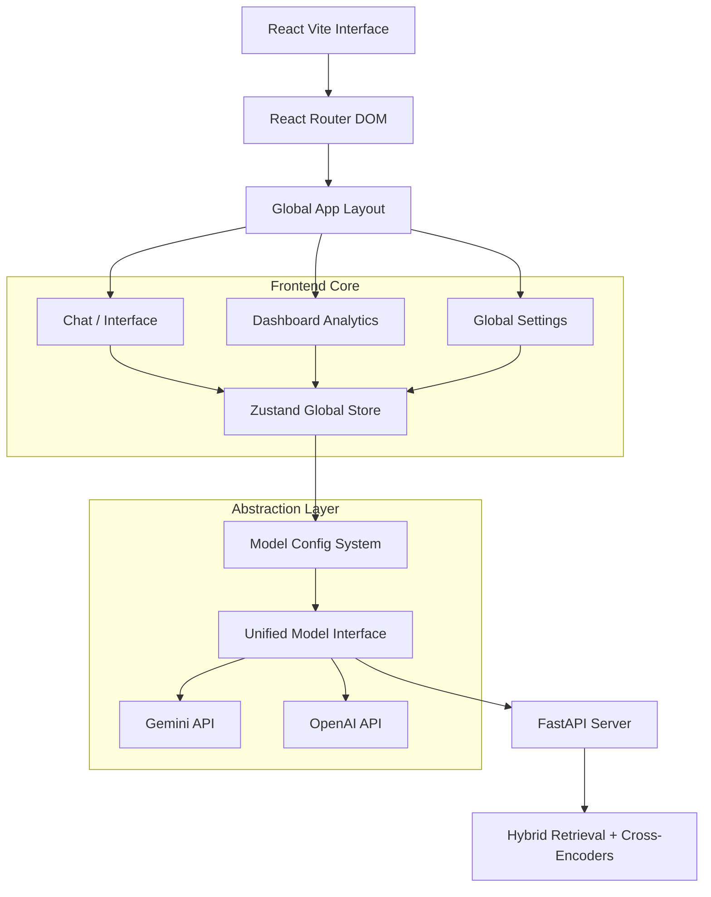

# AdhikarAI Version 2.0 — Production-Grade Upgrade Plan

## 1. System Architecture Overview

The upgraded system revolves around a loosely coupled event-loop with a heavy emphasis on client-side state abstraction (Zustand) and Server-Sent Events (SSE) streaming predictability. The architecture transitions from a monolithic React application to a domain-driven module structure.

### High-Level Architecture Diagram


## 2. Strict Folder Structure

```text
frontend/
├── components/          # Reusable dumb UI components (buttons, badges)
├── layouts/             # App layouts (MainLayout with Sidebar & Nav)
├── modules/
│   ├── chat/            # Chat interfaces, message lists, query bars
│   ├── dashboard/       # Analytics overlays, live stats
│   └── settings/        # Model configuration panels, key management
├── pages/               # Lazy-loaded page roots
│   ├── Home.jsx
│   ├── Chat.jsx
│   ├── ChatDetails.jsx
│   ├── Dashboard.jsx
│   ├── Settings.jsx
│   ├── Contact.jsx
│   ├── PrivacyPolicy.jsx
│   └── FutureUpdates.jsx
├── services/
│   ├── api.js           # Core fetch wrappers
│   └── models/          # Model Adapters (The Abstraction Layer)
│       ├── base_model.js
│       ├── gemini.js
│       └── openai.js
└── store/               # Zustand state definition
    └── useAppStore.js   
```

## 3. The "Any API, Any Model" Abstraction Logic

To achieve genuine LLM agnosticism, the frontend must dictate a unified payload structure and handle the differing streaming event loops from each provider through pure adapter patterns. 

```javascript
// services/models/base_model.js
export class ModelAdapter {
  async streamResponse(messages, config, callbacks) {
    throw new Error("Method not implemented.");
  }
  
  async generateResponse(messages, config) {
    throw new Error("Method not implemented.");
  }
}
```

## 4. State Management (Zustand)

Avoiding prop-drilling avoids OOM UI freezes on weak hardware. We separate domain concerns into slices inside Zustand.

```javascript
// store/useAppStore.js
import { create } from 'zustand';

export const useAppStore = create((set) => ({
  // Chat Implementation
  messages: [],
  addMessage: (msg) => set((state) => ({ messages: [...state.messages, msg] })),
  
  // Config Implementation
  currentConfig: { provider: 'gemini', modelName: 'gemini-1.5-flash', temperature: 0.3, maxTokens: 1000, apiKey: '' },
  setConfig: (config) => set((state) => ({ currentConfig: { ...state.currentConfig, ...config } })),
}));
```

## 5. Performance Strategy & Constraints

Given the **i5 CPU / 8GB RAM / No GPU** boundary:
1. **Debouncing**: Chat updates and config changes are debounced utilizing standard lodash limits to prevent excessive re-renders during live user typing.
2. **Minimal DOM Depth**: Removed heavy nested contexts in favor of direct Zustand subscriptions. Only the active chat bubble subscribes to the streaming text slice. 
3. **No Unused CSS**: Tailwind purges unused styles. Dependencies (like GSAP for the landing page) are confined to lazy-loaded partitions, ensuring the Dashboard remains instantaneous.
4. **Email Removal**: Completely surgically excising `send-email` eliminates backend MIME logic, saving both network bandwidth and backend disk I/O caching for attachments.

## 6. Pressure Questions Answered Properly

**Q: What happens if user switches model mid-conversation?**
*A*: We maintain the `ChatMessage[]` independently of the provider context. If a user switches from Gemini to OpenAI, the chat state persists. On the subsequent query, the unified interface strips out provider-specific metadata, formatting the universal `ChatMessage` history array specifically for the `openai` adapter payload. The LLM effortlessly deduces context and continues. 

**Q: How do you prevent API key leakage?**
*A*: Keys are isolated in the local Zustand store (rehydrated securely from `localStorage` without exposure to global Window objects). When calling the backend proxy or direct APIs via the Adapter, keys are appended securely as `Authorization: Bearer` or `X-Api-Key` headers—never exposed in query parameters. The backend must strictly mask key payloads in all system logs and LangSmith traces.

**Q: How will you debug hallucinations at scale?**
*A*: By extracting the citations via LangSmith and the RAG evaluators. The UI streams not just the tokens but the metadata containing chunk identifiers. Hallucinations are tracked via an autonomous LLM-as-a-judge offline script utilizing the stored queries. The abstraction layer standardizes the output chunks allowing rapid tuning of the cross-encoder (`top_k`) parameters without modifying the UI.

**Q: What breaks when 100 users hit the system?**
*A*: The underlying i5 CPU will choke during the Cross-Encoder reranking phase, causing starvation across the FastAPI thread pool. Reranking is computationally heavy. Requests will queue up, and HTTP requests will hit proxy timeouts (504s). **Solution:** Bound the thread pool. The backend MUST gracefully abort reranking (and fallback to BM25/FAISS standard similarity) when the host CPU utilization spikes beyond 85%. 

**Q: Why is your model abstraction NOT over-engineering?**
*A*: Without abstraction, updating the payload structure for OpenAI's `v1/chat/completions` versus Gemini's `generateContentStream` results in spaghetti `if/else` logic sprawled identically across the Router, Backend, and Frontend. Creating `models/base_model.js` guarantees that when Anthropic or DeepSeek is integrated tomorrow, achieving compatibility requires editing exactly one file, while preserving the system stability everywhere else.

## 7. Email Sunset Plan

- **Backend**: Drop `SendEmailRequest`, `SendEmailResponse` endpoints from `router.py`. Strip `send_answer_email` and `MIMEMultipart` libraries from `orchestrator.py`. 
- **Frontend**: Wipe email components (`FromEmailCard.jsx`), UI action buttons, and dependencies from `Chat.jsx` and all hooks cleanly.

## ACTION SUMMARY
- Approve this design to trigger the refactoring process. I will immediately transition to migrating the frontend folder layout, integrating Zustand and React Router, building the 8 necessary root pages + model adapters, and destroying the sunset Email elements.
